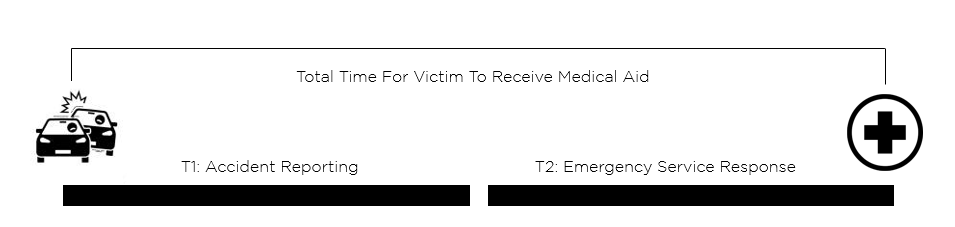

# SENTINEL-X OMEGA

**Agentic AI-Powered Autonomous Multi-Hazard Detection, Prediction and Emergency Response System for Smart Cities**

B.E. Computer Engineering project · Academic Year 2026–2027 · Guide: Prof. Smita Chavan

> **Prototype status.** The full software workflow — video input → detection → temporal
> validation → risk scoring → incident storage → response recommendation → dashboard
> alerts → audit log — is implemented. **No trained hazard model is included yet**, so out
> of the box the system runs a clearly labelled *demo detector* (a colour heuristic for
> fire-like regions). Response actions are **recommendations only**; nothing contacts an
> emergency service. See [Project status](#20-project-status).

---

## 1. Overview

SENTINEL-X OMEGA watches video sources (uploaded files, sample clips, webcams, RTSP/CCTV
streams), detects supported hazards frame by frame, confirms them over time to suppress
false positives, scores their risk, stores confirmed incidents in an SQL database,
recommends which department should respond, and presents everything on a dark
emergency-operations dashboard where operators acknowledge alerts and manage incidents.

## 2. Problem statement

City CCTV networks produce far more footage than control-room staff can watch. Fires,
road accidents, electrical faults and falls are often noticed late. A system that flags
likely hazards, ranks them by risk and suggests a response can shorten reaction time —
provided it is honest about its accuracy and keeps a human operator in control.

## 3. Objectives

1. Accept video or camera input and extract frames.
2. Detect supported hazards with computer vision.
3. Validate detections by confidence and temporal persistence.
4. Compute a configurable risk score and LOW / MEDIUM / HIGH / CRITICAL severity.
5. Create, de-duplicate and store confirmed incidents in SQL.
6. Recommend an emergency response per hazard and severity.
7. Raise dashboard alerts and track acknowledgements.
8. Keep an audit trail and incident history.
9. Clearly separate implemented, simulated and planned capabilities.

## 4. Supported hazard categories

| Hazard | Architecture | Detection available now |
|---|---|---|
| Fire | ✅ | **Demo heuristic only** (colour-based); trained model needed for real detection |
| Smoke | ✅ | Requires trained model |
| Road / vehicle accident | ✅ | Requires trained model |
| Electrical spark | ✅ | Requires trained model |
| Person fall | ✅ | Requires trained model (pose-based approach recommended) |
| Crowd panic | ❌ | Future extension |

A stock COCO YOLO model does **not** recognise any of these hazards. The detector checks
the loaded model's class names and reports `MODEL_NOT_AVAILABLE` if none match.

## 5. System architecture

```mermaid
flowchart LR
    IN[Video file / webcam / RTSP] --> FE[Frame extraction<br/>OpenCV]
    FE --> PRE[Preprocessing]
    PRE --> DET[Detection Agent<br/>YOLO or labelled demo]
    DET --> CONF[Confidence filter]
    CONF --> TEMP[Temporal validation]
    TEMP --> RISK[Risk Assessment Agent]
    RISK --> INC[Incident Management Agent]
    INC --> DB[(SQL database)]
    INC --> RESP[Response Recommendation Agent]
    RESP --> ALERT[Alert Agent]
    ALERT --> DB
    DB --> API[FastAPI /api/v1]
    API --> UI[Web dashboard]
    INC -.-> AUD[Audit Agent]
    ALERT -.-> AUD
    AUD --> DB
```



**Workflow:** an operator starts monitoring a camera (or uploads a clip) → a background
job reads every *N*-th frame → the detector returns boxes and confidences → detections
below the hazard's threshold are dropped → the temporal validator confirms a hazard only
after it persists across several frames → the risk agent scores it → the incident agent
creates a new incident or merges it into an open one for the same camera → response
recommendations and a dashboard alert are stored → every decision is written to the
audit log → the dashboard polls the API and shows it.

The "agents" are separate, testable Python components with explicit inputs/outputs,
called in sequence by an orchestrator — not autonomous AI agents. Details:
[docs/architecture/architecture.md](docs/architecture/architecture.md).

## 6. Technology stack

| Layer | Technology |
|---|---|
| Computer vision | Python 3.11+, OpenCV, Ultralytics YOLO + PyTorch (optional, for trained models) |
| Backend | FastAPI, Pydantic v2, SQLAlchemy 2.0, PyJWT, bcrypt |
| Database | SQLite (prototype), PostgreSQL-compatible schema |
| Frontend | HTML5, CSS3, vanilla JavaScript (ES modules), SVG charts — no build step, works offline |
| Testing | pytest, FastAPI TestClient (httpx) |

## 7. Repository structure

```text
sentinel-x-omega/
├── README.md  LICENSE  .gitignore  .env.example  pytest.ini
├── requirements.txt          # core app + tests
├── requirements-ml.txt       # optional: ultralytics / torch
├── backend/app/
│   ├── main.py               # FastAPI app factory, error envelope, static dashboard
│   ├── api/deps.py           # auth, roles, pagination dependencies
│   ├── api/v1/               # health, auth, cameras(+locations), detection, incidents, alerts, dashboard, system
│   ├── core/                 # config, enums, errors, logging, security, validators
│   ├── models/               # SQLAlchemy models (one file per table)
│   ├── schemas/              # Pydantic request/response models
│   ├── services/             # risk, response, incident, alert, audit agents; pipeline; jobs
│   ├── ai/                   # video_source, preprocessor, detector, postprocessor
│   └── database/connection.py
├── frontend/                 # index.html, css/, js/ (app, api, dashboard helpers), pages/ (one module per page)
├── ml/                       # training/, evaluation/, models/ (weights, git-ignored)
├── data/                     # sample_videos/, test_data/, uploads/ (contents git-ignored)
├── docs/                     # architecture/, api/, database/, testing/
├── scripts/                  # run_demo.py, setup/{init_db,create_admin,seed_demo,generate_sample_video}.py
└── tests/                    # unit/, integration/, system/
```

Changes from the suggested structure: `ai/video_source.py` (camera/file input),
`services/pipeline.py` (DB-free orchestrator), `services/incident_workflow.py` (DB sink),
`services/response_service.py` and `audit_service.py` (separate agents), `api/v1/auth.py`
and `system.py`, `core/enums.py`, `core/errors.py`, `core/validators.py`, `pytest.ini`,
`requirements-ml.txt`. `frontend/pages/` holds JavaScript page modules for the
single-page dashboard rather than separate HTML pages.

## 8. Installation requirements

* Python **3.11 or newer** (3.11–3.13 targeted)
* pip and venv; Git
* A modern browser (Chrome, Edge, Firefox)
* Optional: webcam; NVIDIA GPU + CUDA for trained-model inference/training

## 9. Environment setup

```bash
git clone https://github.com/<your-account>/sentinel-x-omega.git
cd sentinel-x-omega
python -m venv .venv
# Windows: .venv\Scripts\activate     Linux/macOS: source .venv/bin/activate
pip install -r requirements.txt
cp .env.example .env                    # Windows: copy .env.example .env
python -c "import secrets; print(secrets.token_urlsafe(48))"   # paste into JWT_SECRET_KEY in .env
```

## 10. Backend startup

```bash
python scripts/setup/init_db.py                                  # create tables
python scripts/setup/create_admin.py --email admin@example.com --name "Admin"   # prompts for password
python scripts/setup/seed_demo.py                                # demo locations + cameras + synthetic clip
uvicorn backend.app.main:app --reload                            # http://localhost:8000
```

Operator/viewer accounts: `create_admin.py --role OPERATOR` / `--role VIEWER`.

## 11. Frontend startup

The dashboard is served by the backend — open **http://localhost:8000/** and sign in.
No build step is needed. To host it separately (e.g. `python -m http.server 5500` inside
`frontend/`), add that origin to `CORS_ORIGINS` and set the API URL on the Settings page.

Pages: Overview · Live monitoring · Cameras · Incidents · Incident detail · Alerts ·
Locations (map) · Analytics · Settings (configuration + audit log).

## 12. API documentation

Interactive docs: **http://localhost:8000/docs**. Reference with error codes, roles and
curl examples: [docs/api/api.md](docs/api/api.md).

| Area | Endpoints |
|---|---|
| Health | `GET /api/v1/health` |
| Auth | `POST /api/v1/auth/login`, `GET /api/v1/auth/me` |
| Cameras | `GET/POST /api/v1/cameras`, `GET/PUT/DELETE /api/v1/cameras/{id}`, `GET/POST /api/v1/locations` |
| Detection | `GET /detection/status`, `POST /detection/analyze`, `POST /detection/start`, `POST /detection/stop`, `GET /detection/jobs/{id}`, `GET /detection/jobs/{id}/snapshot` |
| Incidents | `GET/POST /api/v1/incidents`, `GET/PATCH /api/v1/incidents/{id}` |
| Alerts | `GET /api/v1/alerts`, `PATCH /api/v1/alerts/{id}/acknowledge` |
| Dashboard | `GET /api/v1/dashboard/summary` |
| System | `GET /api/v1/system/config`, `GET /api/v1/system/logs` |

## 13. Database schema overview

Tables: `users`, `locations`, `cameras`, `incidents`, `detections`, `alerts`,
`response_actions`, `system_logs`. ER diagram, columns, indexes and referential actions:
[docs/database/schema.md](docs/database/schema.md).

## 14. AI model configuration

| Setting | Default | Meaning |
|---|---|---|
| `DETECTOR_MODE` | `auto` | `yolo` (trained model only), `auto` (model else demo), `demo` |
| `MODEL_WEIGHTS_PATH` | `ml/models/hazard_yolo.pt` | local weights file — never downloaded automatically |
| `MODEL_CLASS_MAP` | fire, smoke, accident, spark, fall … | model class name → hazard type |
| `FRAME_STRIDE` | 5 | analyse every 5th frame |
| `DEFAULT_CONFIDENCE_THRESHOLD` / `CONFIDENCE_THRESHOLDS` | 0.50 / per hazard | detection filter |
| `TEMPORAL_MIN_HITS` / `TEMPORAL_WINDOW_FRAMES` | 5 / 8 | confirmation rule |
| `RISK_WEIGHT_*`, `HAZARD_SEVERITY_FACTORS`, `SEVERITY_BAND_*` | 0.4/0.3/0.3, see docs | risk model (design parameters) |
| `INCIDENT_DEDUP_WINDOW_SECONDS` | 300 | merge window for repeated events |

Risk score: `100 × (w_c·confidence + w_p·persistence + w_s·hazard factor)`, always 0–100;
bands LOW ≤ 30 < MEDIUM ≤ 55 < HIGH ≤ 75 < CRITICAL. These are **prototype design
parameters, not validated predictions**. To train a real model see [ml/README.md](ml/README.md).

## 15. Demo instructions

**Dashboard demo**

1. Complete steps 9–10 (including `seed_demo.py`).
2. Open http://localhost:8000, sign in, note the yellow **Demo detector** badge.
3. *Live monitoring* → **Start** on "Demo Feed - Synthetic". Within a few seconds (sample files are processed faster than real time) a FIRE incident
   appears (tagged *Demo*), with a Fire Brigade recommendation and an alert.
4. Open the incident, acknowledge the alert, set status to *Resolved*; watch Overview and
   Analytics update. Or upload any short clip under *Analyse a video file*.

**Command-line demo (no server)**

```bash
python scripts/run_demo.py --no-db          # synthetic clip, in-memory results
python scripts/run_demo.py --video my.mp4   # your clip, stored in the database
```

The synthetic clip is computer-generated (no real fire): a single-frame flash that must be
ignored and a flickering orange blob that must become exactly one incident.

## 16. Testing instructions

```bash
pytest                    # all tests
pytest tests/unit         # pure logic (no DB/server)
pytest tests/integration  # database, services, REST API
pytest tests/system       # end-to-end pipeline and CLI
```

Test plan, coverage of each requirement and the execution record:
[docs/testing/testing.md](docs/testing/testing.md).

## 17. Known limitations

* No trained hazard model is included; accuracy figures do not exist yet.
* The demo detector reacts to any bright orange/red region and detects nothing else.
* Bounding-box detection is a weak fit for accidents and falls.
* Simultaneous hazards of the same type in one view merge into one event.
* Monitoring shows a periodically refreshed processed frame, not a live video stream.
* Job state is in memory and is lost on restart (incidents persist).
* Camera credentials are masked in the API but not encrypted at rest.
* No rate limiting, refresh tokens or user-management UI.
* CPU inference on long, high-resolution videos is slow.
* No SMS/e-mail/siren notifications and **no emergency dispatch integration**.

## 18. Future enhancements

* Train and evaluate a custom YOLO model on licensed fire/smoke/spark/accident datasets.
* Pose-estimation + sequence model for fall detection; crowd-panic detection.
* Task queue (e.g. Celery/RQ) and PostgreSQL for many concurrent cameras; Alembic migrations.
* WebSocket push updates and an MJPEG/WebRTC live view.
* Encrypted credential storage, refresh tokens, login throttling, user-admin UI.
* Real map tiles (Leaflet + OpenStreetMap) and GIS layers.
* Verified notification channels (SMS/e-mail) with human approval, and only through
  officially sanctioned integrations for any dispatch.

## 19. Team information

| Name | Roll No. |
|---|---|
| Rahul Deshmukh | 21 |
| Vaishnavi Bhamare | 12 |
| Mandar Shubhekar *(spelling to be confirmed against college records)* | — |

Project guide: **Prof. Smita Chavan** · Department of Computer Engineering · 2026–2027

## 20. Project status

| Component | Status |
|---|---|
| Video input (file, webcam, RTSP), frame extraction, preprocessing | Implemented |
| Detector interface, YOLO wrapper with class verification | Implemented — **no trained weights yet** |
| Demo detector | Implemented — **demonstration only** |
| Confidence filter, temporal validation, duplicate prevention | Implemented, unit-tested |
| Risk assessment, response recommendation | Implemented, unit-tested — **parameters not validated** |
| Incident / alert / audit persistence, REST API, JWT auth, roles | Implemented — integration tests written; see execution record |
| Dashboard (9 sections) wired to the API | Implemented — manual checklist in docs/testing |
| External notifications / emergency dispatch | **Not implemented** (by design) |
| Model accuracy evaluation | **Not done** — requires a trained model |


# Computer Vision Based CCTV Accident Detection  

### Introduction
Every year, road accidents claim the lives of **1.3 million** people, with over **50 million** people suffering injuries that are non fatal. The repercussions of these accidents extend far beyond the loss of lives, costing most countries upto **3% of their Gross Domestic Product**.   
  
One of the reasons for the high fatalities of these accidents is the **lack of timely medical attention** given to the victims. The total time taken for this first aid to reach the victim can be divided into two segments, T1 and T2.  
  
  
<p align="center">Time Breakdown</p>   

T1 is the time between the accident occurring and it being reported to the nearest emergency center or hospital. This is the **segment that has the most variation**, as for an accident to be reported, there must be someone present at the scene of the accident to manually inform the center that the accident had occurred. Certain modern car models are fitted with sensor arrays and systems that report these accidents, but the vast majority of vehicles across the country and the world are not equipped with these services.  

T2 is the time between the accident being reported and the medical aid reaching the victim. This **segment is more controlled**, with efficient systems in place that dispatches medical aid quickly. The only hurdles faced in this segment are the ones that cannot be controlled, such as weather conditions, road traffic and so on.  

The sum total of both these segments should be under an hour, in order for the victim to have the best possible chances of survival. The segment with the **best chance of improvement** is the time taken for the accident to be **reported** or **T1**. Our goal is to minimize this, by automatically detecting accidents through the CCTV camera network that already exists, and allowing emergency care centers to instantly dispatch medical aid. This gives the victim the best possible chance to receive care in the golden hour, maximizing their chances of survival.  

### Proposed Solution  
Combining the various editing methods, we propose a solution that not only makes use of Deep Learning based feature extraction but also takes into consideration the locality of the occurred accident in terms of the entire frame by leveraging state of the art Object Detection methodologies combined with a custom collision detection algorithm. The approach to accident detection can be classified into two separate stages.  
• **Detection of Vehicles** involved in an accident via object detection and a **collision detection algorithm** 
• **Classification** of the detected accident by the use of two separate CNN and ANN models.  
  – Google’s **Densenet-201** for primary feature extraction.  
  – A **fully connected multi layer neural network**.  

#### Step 1: Object Detection using YOLOv4  
YOLO is an algorithm that provides real-time object detection using neural networks. The popularity of this algorithm is due to its **accuracy and quickness**. It has been applied in a variety of ways to identify objects such as people, animals and vehicles. Various methods are used for object identification, including **Retina-Net, fast R-CNN, and Single-Shot MultiBox Detector (SSD)**. These methods have addressed the problems of data scarcity and modelling in object detection, however they **cannot find objects in a single algorithm run**. Due to its better performance over the aforementioned object identification approaches, the YOLO algorithm has grown in popularity.  
  
YOLO works in real-time depending on the hardware used to run it. It takes in an input image and produces an output bounding box which consists of the coordinates in two dimensional space with respect to an image. In our particular use-case, we made use of YOLOv4 which has better accuracy and efficiency when compared to it’s predecessors. We made use of the **pre-trained YOLOv4 model** and further **trained on 10,000 images of cars** with their bounding box annotated.  
  
  
<p align="center">YOLOv4 detecting vehicles involved in the accident</p>   

#### Step 2: Collision Detection  
After we detect the vehicles in the frame, we move onto the collision detection step. Our intention is to **localise the region where an accident might have happened**, instead of attempting to detect the accident on an entire frame. The algorithm designed for the same is based on the **Axis Aligned Bounding Box(AABB)**, where the edges of the box are parallel to the Cartesian coordinate axes. We take the bounding boxes of the detected vehicles and their coordinates as used by OpenCV where the origin of the image is located at the upper-left hand corner. We then take the horizontal and vertical distances between the centres of the two detected bounding boxes, and subtract the half widths and half heights of the boxes from them respectively to determine if the boxes overlap. If the resultant value is negative in both cases, we can confirm that the boxes overlap, and there might be an accident.  

To counter an irregularity in the object detection process where two vehicles on impact are detected as a single object as seen in the figure below, we check if the **resultant values are less than 5% of the half width and height**, to allow the algorithm to shortlist cases where the vehicles are about to collide. As this algorithm only involves checking ranges of coordinate values, it is computationally less intensive than other approaches such as Intersection over Union, and this also allows us to quickly eliminate objects that are far apart in the frame, allowing us to process situations with multiple objects in the frame quickly.  
  
  
<p align="center">Axis Aligned Bounding Box Collision Detection Algorithm</p>  
  
#### Step 3: Feature Extraction using Densenet-201 and Classification  
After we detect a possible accident using the collision detection algorithm, we crop the region of the image where the collision was detected and is sent to a classifier that predicts the probability that an accident has occurred in that region. By doing so, we minimise cases where cars pass close by each other but do not necessarily collide.  

**DenseNet-201** is a Convolutional Neural Network that has 201 layers where each layer obtains inputs from all preceding layers and passes its own feature maps to the subsequent layers where it focuses on concatenating the outputs from the previous layers instead of using a summation. Since each layer receives feature maps from the preceding layers, the network can be thinner and more compact. This helps achieve higher computational and memory efficiency.   
  
  
<p align="center">Working of Densenet-201</p>  
  
Feature extraction being performed by the Densenet-201 model produces a **feature vector of shape (1,1920)** which on flattening gives a vector of **(1920,)**. Each image is resized to **224x224x3 pixels** which is then resized to **(1,224,224,3)** which is the input format required by Densenet-201. 
  
     
<p align="center">Densenet-201 Architecture</p>  
  
After the extraction of features, these features are then fed to an **Artificial Neural Network** which then handles the task of accident classification. The output of the Densenet-201 model produces a vector of length 1920 which basically contains the required features of the input image.This (1920,1) dimension vector is fed to a Neural Network with an input layer of 16 neurons, followed by two hidden layers of 32 and 16 neurons each and a final output layer.  
  
Between each layer, there exists a dropout layer to prevent over-fitting, a Rectified Linear Unit (ReLU) and a Sigmoid activation function between the last hidden layer and the output layer. Having a single output neuron would allow for the specification for minimising false positive cases. In our case we set the **threshold to be 0.82**, this causes all of the accidents with probability 0.82 to be classified as an accident.  

### System Block Diagram  
  

### Dataset  
The dataset contains 5000 images divided into two classes: Accidents and Non-Accidents.   
  
The **Accident** class is made up of **2500 images of various types and angles of accidents**. This data was extracted from CCTV Video footage uploaded to Youtube along with Google image results. We experimented with simulated footage using Beam.NG, an extremely detailed and authentic vehicle simulation software. However, we felt that the simulated footage was **not photo-realistic enough** and did not complement the existing dataset well, so we chose to not use it. We also manually cleaned the Accident class, and removed images that did not belong to the class or was not good enough to be a part of the dataset.  
  
  
     
 
    
  
  
The **Non-Accident** class is also made up of **2500 images**, and mainly consists of various situations where vehicles are close to each other, and might appear to collide but are not. This class is crucial as it helps the model differentiate between cases where vehicles have actually collided and cases where the vehicles are close to each other but have not collided. This class ensures that the false positive alerts raised are kept in check.  
  
 
    
 
     
  
  
### Testing  
For the end-to-end testing process, we utilized a **test video set of 10 videos**, captured in **varied conditions**. These videos were not included in the training dataset, to ensure the most accurate testing scenarios.  
  
The Deep Learning model’s performance was tested based on our dataset. The dataset was split into train, test and evaluation data at **60% for training, 20% for testing and and the remaining 20% for evaluation** of the models performance. This testing resulted in an **accuracy of 97%** of the deep learning models in classification of accident images vs non-accident images.  

The images below show a few test videos where the system was correctly able to identify the collision and predict the accident across different conditions.  
  
  
  
  
  
  

After the testing process, our model was able to **correctly** identify accidents in **9 out of 10** accident videos, giving us an accuracy of **90%**. Another tool used for testing the performance of the model was Beam.NG, an accurate physics based vehicle simulator. We simulated accidents, and used the captured footage to test the model as seen in the figures below. 
  
  
  
  
  
To test for false positives, we used a **looped video** as seen in the figure below. These videos show vehicles in **close proximity** to each other, at different angles. Our model was able to process the entire video **without raising any accidents***, showcasing its ability to reject potential false positive results, improving the overall reliability of the system.  
  
  

To test for the latency or the time taken for the accident to be detected and reported, testing was performed on a machine with **8 Gigabytes of Video Memory** and **16 Gigabytes Random Access Memory**. This testing setup resulted in near real-time results with an average of **45 frames per second**.  

### Experimentation  
Extensive experimentation was carried out when working with this particular 2 stage accident detection system. When approaching the problem of object detection, various models were experimented with to compare and contrast between their accuracy and efficiency. In terms of object detection as a whole, **Single Stage detectors** outperform all other methods of object detection and **YOLOv4 seems to outperform any other single stage detector. Within YOLO itself, there exist variations of the model for further fine tuning of accuracy and efficiency but the **base YOLOv4** seemed to have a good balance between both of the metrics and we proceeded with this instead.  
  
Collision Detection is a significant part of accident detection and we needed to ensure that the algorithm we chose would not lead to multiple false positives. As mentioned earlier, we made use of a variation of the **Axis Aligned Bounding Box (AABB)** method instead of the standard **Intersection over Union (IOU)** method. The reason for this is due to the relative position of the accident with respect to the CCTV camera footage. In the case where the accident is a distance away from the camera, the **IOU method fails to take into consideration the actual percentage of overlap** whereas the AABB method handles this effectively.  

In the second stage of the system, from the view point of feature extraction, various methodologies such as **Histogram of Gradients (HOG)** and **Canny edge detection**. Older methods such as edge detection seemed to provide average results due it the edge detection being dependent on the surroundings of the accident, although many features of a car crash isn’t brought to context by Canny edge detection, it does extract useful information from the image and provide reasonable accuracy. Other feature detection algorithms such as **Speeded Up Robust Features**, **Scale-Invariant feature transform** have been tested with similar images and have been found to perform poorly in comparison to CNNs. We make use of **F1 score** as a metric used for comparison. Accuracy is used when the True positives and true negatives are important whereas f1 score also takes into account the false positives and false negatives. In our use case, false negatives are to be minimised as every accident should be identified. As mentioned earlier, we make use of a CNN for feature extraction combined with an ANN for classification. Experimentation was done with various models such as **Resnet-50, Densenet, Inception-v3 and VGG16** all with a threshold probability score of **0.6**.  
  
When coming to the ANN that was used for classification, it consists of 3 hidden layers. The layers consist of 8, 32, and 16 neutrons respectively. In between each layer, there exists a dropout layer to prevent overfitting and a ReLU activation function as well. The final output layer consists of a **single output neuron** with a sigmoid activation function. The model was trained with a **binary crosentrpoy loss** and the **Adam optimizer** with a **learning rate of 0.001** for **30 epochs** and a **batch size of 512**.  

### Results  
We evaluated the data against 20% of the original dataset as evaluation data and the results are as shown in the table.  

| CNN Architecture | F1-Score (N) |
|------------------|--------------|
| Resnet-50        | 0.95         |
| Densenet-201     | 0.97         |
| Inception-v3     | 0.94         |
| VGG16            | 0.93         |
  
From the results we see that the Densenet-201 architecture performs significantly better than the other CNNs for feature extraction, in the case of the end to end system, we trained the model on all of the images from our dataset and tested it on videos of accidents.  
  
  
<p align="center">Train vs Test Accuracy</p>  

  
<p align="center">Train vs Test Loss</p>  
