# SENTINEL-X OMEGA

**Agentic AI-Powered Autonomous Multi-Hazard Detection, Prediction and Emergency Response System for Smart Cities**

B.E. Computer Engineering project · Academic Year 2026–2027 · Guide: Prof. Smita Chavan

> **Prototype status.** The full software workflow — video input → detection → temporal
> validation → risk scoring → incident storage → response recommendation → dashboard
> alerts → audit log — is implemented. **No trained hazard model is included yet**, so out
> of the box the system runs a clearly labelled *demo detector* (a colour heuristic for
> fire-like regions). Response actions are **recommendations only**; nothing contacts an
> emergency service. See [Project status](#20-project-status).

---

## 1. Overview

SENTINEL-X OMEGA watches video sources (uploaded files, sample clips, webcams, RTSP/CCTV
streams), detects supported hazards frame by frame, confirms them over time to suppress
false positives, scores their risk, stores confirmed incidents in an SQL database,
recommends which department should respond, and presents everything on a dark
emergency-operations dashboard where operators acknowledge alerts and manage incidents.

## 2. Problem statement

City CCTV networks produce far more footage than control-room staff can watch. Fires,
road accidents, electrical faults and falls are often noticed late. A system that flags
likely hazards, ranks them by risk and suggests a response can shorten reaction time —
provided it is honest about its accuracy and keeps a human operator in control.

## 3. Objectives

1. Accept video or camera input and extract frames.
2. Detect supported hazards with computer vision.
3. Validate detections by confidence and temporal persistence.
4. Compute a configurable risk score and LOW / MEDIUM / HIGH / CRITICAL severity.
5. Create, de-duplicate and store confirmed incidents in SQL.
6. Recommend an emergency response per hazard and severity.
7. Raise dashboard alerts and track acknowledgements.
8. Keep an audit trail and incident history.
9. Clearly separate implemented, simulated and planned capabilities.

## 4. Supported hazard categories

| Hazard | Architecture | Detection available now |
|---|---|---|
| Fire | ✅ | **Demo heuristic only** (colour-based); trained model needed for real detection |
| Smoke | ✅ | Requires trained model |
| Road / vehicle accident | ✅ | Requires trained model |
| Electrical spark | ✅ | Requires trained model |
| Person fall | ✅ | Requires trained model (pose-based approach recommended) |
| Crowd panic | ❌ | Future extension |

A stock COCO YOLO model does **not** recognise any of these hazards. The detector checks
the loaded model's class names and reports `MODEL_NOT_AVAILABLE` if none match.

## 5. System architecture

```mermaid
flowchart LR
    IN[Video file / webcam / RTSP] --> FE[Frame extraction<br/>OpenCV]
    FE --> PRE[Preprocessing]
    PRE --> DET[Detection Agent<br/>YOLO or labelled demo]
    DET --> CONF[Confidence filter]
    CONF --> TEMP[Temporal validation]
    TEMP --> RISK[Risk Assessment Agent]
    RISK --> INC[Incident Management Agent]
    INC --> DB[(SQL database)]
    INC --> RESP[Response Recommendation Agent]
    RESP --> ALERT[Alert Agent]
    ALERT --> DB
    DB --> API[FastAPI /api/v1]
    API --> UI[Web dashboard]
    INC -.-> AUD[Audit Agent]
    ALERT -.-> AUD
    AUD --> DB
```



**Workflow:** an operator starts monitoring a camera (or uploads a clip) → a background
job reads every *N*-th frame → the detector returns boxes and confidences → detections
below the hazard's threshold are dropped → the temporal validator confirms a hazard only
after it persists across several frames → the risk agent scores it → the incident agent
creates a new incident or merges it into an open one for the same camera → response
recommendations and a dashboard alert are stored → every decision is written to the
audit log → the dashboard polls the API and shows it.

The "agents" are separate, testable Python components with explicit inputs/outputs,
called in sequence by an orchestrator — not autonomous AI agents. Details:
[docs/architecture/architecture.md](docs/architecture/architecture.md).

## 6. Technology stack

| Layer | Technology |
|---|---|
| Computer vision | Python 3.11+, OpenCV, Ultralytics YOLO + PyTorch (optional, for trained models) |
| Backend | FastAPI, Pydantic v2, SQLAlchemy 2.0, PyJWT, bcrypt |
| Database | SQLite (prototype), PostgreSQL-compatible schema |
| Frontend | HTML5, CSS3, vanilla JavaScript (ES modules), SVG charts — no build step, works offline |
| Testing | pytest, FastAPI TestClient (httpx) |

## 7. Repository structure

```text
sentinel-x-omega/
├── README.md  LICENSE  .gitignore  .env.example  pytest.ini
├── requirements.txt          # core app + tests
├── requirements-ml.txt       # optional: ultralytics / torch
├── backend/app/
│   ├── main.py               # FastAPI app factory, error envelope, static dashboard
│   ├── api/deps.py           # auth, roles, pagination dependencies
│   ├── api/v1/               # health, auth, cameras(+locations), detection, incidents, alerts, dashboard, system
│   ├── core/                 # config, enums, errors, logging, security, validators
│   ├── models/               # SQLAlchemy models (one file per table)
│   ├── schemas/              # Pydantic request/response models
│   ├── services/             # risk, response, incident, alert, audit agents; pipeline; jobs
│   ├── ai/                   # video_source, preprocessor, detector, postprocessor
│   └── database/connection.py
├── frontend/                 # index.html, css/, js/ (app, api, dashboard helpers), pages/ (one module per page)
├── ml/                       # training/, evaluation/, models/ (weights, git-ignored)
├── data/                     # sample_videos/, test_data/, uploads/ (contents git-ignored)
├── docs/                     # architecture/, api/, database/, testing/
├── scripts/                  # run_demo.py, setup/{init_db,create_admin,seed_demo,generate_sample_video}.py
└── tests/                    # unit/, integration/, system/
```

Changes from the suggested structure: `ai/video_source.py` (camera/file input),
`services/pipeline.py` (DB-free orchestrator), `services/incident_workflow.py` (DB sink),
`services/response_service.py` and `audit_service.py` (separate agents), `api/v1/auth.py`
and `system.py`, `core/enums.py`, `core/errors.py`, `core/validators.py`, `pytest.ini`,
`requirements-ml.txt`. `frontend/pages/` holds JavaScript page modules for the
single-page dashboard rather than separate HTML pages.

## 8. Installation requirements

* Python **3.11 or newer** (3.11–3.13 targeted)
* pip and venv; Git
* A modern browser (Chrome, Edge, Firefox)
* Optional: webcam; NVIDIA GPU + CUDA for trained-model inference/training

## 9. Environment setup

```bash
git clone https://github.com/<your-account>/sentinel-x-omega.git
cd sentinel-x-omega
python -m venv .venv
# Windows: .venv\Scripts\activate     Linux/macOS: source .venv/bin/activate
pip install -r requirements.txt
cp .env.example .env                    # Windows: copy .env.example .env
python -c "import secrets; print(secrets.token_urlsafe(48))"   # paste into JWT_SECRET_KEY in .env
```

## 10. Backend startup

```bash
python scripts/setup/init_db.py                                  # create tables
python scripts/setup/create_admin.py --email admin@example.com --name "Admin"   # prompts for password
python scripts/setup/seed_demo.py                                # demo locations + cameras + synthetic clip
uvicorn backend.app.main:app --reload                            # http://localhost:8000
```

Operator/viewer accounts: `create_admin.py --role OPERATOR` / `--role VIEWER`.

## 11. Frontend startup

The dashboard is served by the backend — open **http://localhost:8000/** and sign in.
No build step is needed. To host it separately (e.g. `python -m http.server 5500` inside
`frontend/`), add that origin to `CORS_ORIGINS` and set the API URL on the Settings page.

Pages: Overview · Live monitoring · Cameras · Incidents · Incident detail · Alerts ·
Locations (map) · Analytics · Settings (configuration + audit log).

## 12. API documentation

Interactive docs: **http://localhost:8000/docs**. Reference with error codes, roles and
curl examples: [docs/api/api.md](docs/api/api.md).

| Area | Endpoints |
|---|---|
| Health | `GET /api/v1/health` |
| Auth | `POST /api/v1/auth/login`, `GET /api/v1/auth/me` |
| Cameras | `GET/POST /api/v1/cameras`, `GET/PUT/DELETE /api/v1/cameras/{id}`, `GET/POST /api/v1/locations` |
| Detection | `GET /detection/status`, `POST /detection/analyze`, `POST /detection/start`, `POST /detection/stop`, `GET /detection/jobs/{id}`, `GET /detection/jobs/{id}/snapshot` |
| Incidents | `GET/POST /api/v1/incidents`, `GET/PATCH /api/v1/incidents/{id}` |
| Alerts | `GET /api/v1/alerts`, `PATCH /api/v1/alerts/{id}/acknowledge` |
| Dashboard | `GET /api/v1/dashboard/summary` |
| System | `GET /api/v1/system/config`, `GET /api/v1/system/logs` |

## 13. Database schema overview

Tables: `users`, `locations`, `cameras`, `incidents`, `detections`, `alerts`,
`response_actions`, `system_logs`. ER diagram, columns, indexes and referential actions:
[docs/database/schema.md](docs/database/schema.md).

## 14. AI model configuration

| Setting | Default | Meaning |
|---|---|---|
| `DETECTOR_MODE` | `auto` | `yolo` (trained model only), `auto` (model else demo), `demo` |
| `MODEL_WEIGHTS_PATH` | `ml/models/hazard_yolo.pt` | local weights file — never downloaded automatically |
| `MODEL_CLASS_MAP` | fire, smoke, accident, spark, fall … | model class name → hazard type |
| `FRAME_STRIDE` | 5 | analyse every 5th frame |
| `DEFAULT_CONFIDENCE_THRESHOLD` / `CONFIDENCE_THRESHOLDS` | 0.50 / per hazard | detection filter |
| `TEMPORAL_MIN_HITS` / `TEMPORAL_WINDOW_FRAMES` | 5 / 8 | confirmation rule |
| `RISK_WEIGHT_*`, `HAZARD_SEVERITY_FACTORS`, `SEVERITY_BAND_*` | 0.4/0.3/0.3, see docs | risk model (design parameters) |
| `INCIDENT_DEDUP_WINDOW_SECONDS` | 300 | merge window for repeated events |

Risk score: `100 × (w_c·confidence + w_p·persistence + w_s·hazard factor)`, always 0–100;
bands LOW ≤ 30 < MEDIUM ≤ 55 < HIGH ≤ 75 < CRITICAL. These are **prototype design
parameters, not validated predictions**. To train a real model see [ml/README.md](ml/README.md).

## 15. Demo instructions

**Dashboard demo**

1. Complete steps 9–10 (including `seed_demo.py`).
2. Open http://localhost:8000, sign in, note the yellow **Demo detector** badge.
3. *Live monitoring* → **Start** on "Demo Feed - Synthetic". Within a few seconds (sample files are processed faster than real time) a FIRE incident
   appears (tagged *Demo*), with a Fire Brigade recommendation and an alert.
4. Open the incident, acknowledge the alert, set status to *Resolved*; watch Overview and
   Analytics update. Or upload any short clip under *Analyse a video file*.

**Command-line demo (no server)**

```bash
python scripts/run_demo.py --no-db          # synthetic clip, in-memory results
python scripts/run_demo.py --video my.mp4   # your clip, stored in the database
```

The synthetic clip is computer-generated (no real fire): a single-frame flash that must be
ignored and a flickering orange blob that must become exactly one incident.

## 16. Testing instructions

```bash
pytest                    # all tests
pytest tests/unit         # pure logic (no DB/server)
pytest tests/integration  # database, services, REST API
pytest tests/system       # end-to-end pipeline and CLI
```

Test plan, coverage of each requirement and the execution record:
[docs/testing/testing.md](docs/testing/testing.md).

## 17. Known limitations

* No trained hazard model is included; accuracy figures do not exist yet.
* The demo detector reacts to any bright orange/red region and detects nothing else.
* Bounding-box detection is a weak fit for accidents and falls.
* Simultaneous hazards of the same type in one view merge into one event.
* Monitoring shows a periodically refreshed processed frame, not a live video stream.
* Job state is in memory and is lost on restart (incidents persist).
* Camera credentials are masked in the API but not encrypted at rest.
* No rate limiting, refresh tokens or user-management UI.
* CPU inference on long, high-resolution videos is slow.
* No SMS/e-mail/siren notifications and **no emergency dispatch integration**.

## 18. Future enhancements

* Train and evaluate a custom YOLO model on licensed fire/smoke/spark/accident datasets.
* Pose-estimation + sequence model for fall detection; crowd-panic detection.
* Task queue (e.g. Celery/RQ) and PostgreSQL for many concurrent cameras; Alembic migrations.
* WebSocket push updates and an MJPEG/WebRTC live view.
* Encrypted credential storage, refresh tokens, login throttling, user-admin UI.
* Real map tiles (Leaflet + OpenStreetMap) and GIS layers.
* Verified notification channels (SMS/e-mail) with human approval, and only through
  officially sanctioned integrations for any dispatch.

## 19. Team information

| Name | Roll No. |
|---|---|
| Rahul Deshmukh | 21 |
| Vaishnavi Bhamare | 12 |
| Mandar Shubhekar *(spelling to be confirmed against college records)* | — |

Project guide: **Prof. Smita Chavan** · Department of Computer Engineering · 2026–2027

## 20. Project status

| Component | Status |
|---|---|
| Video input (file, webcam, RTSP), frame extraction, preprocessing | Implemented |
| Detector interface, YOLO wrapper with class verification | Implemented — **no trained weights yet** |
| Demo detector | Implemented — **demonstration only** |
| Confidence filter, temporal validation, duplicate prevention | Implemented, unit-tested |
| Risk assessment, response recommendation | Implemented, unit-tested — **parameters not validated** |
| Incident / alert / audit persistence, REST API, JWT auth, roles | Implemented — integration tests written; see execution record |
| Dashboard (9 sections) wired to the API | Implemented — manual checklist in docs/testing |
| External notifications / emergency dispatch | **Not implemented** (by design) |
| Model accuracy evaluation | **Not done** — requires a trained model |
