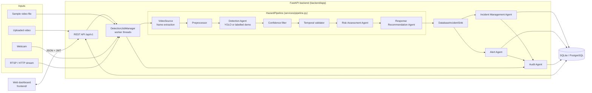
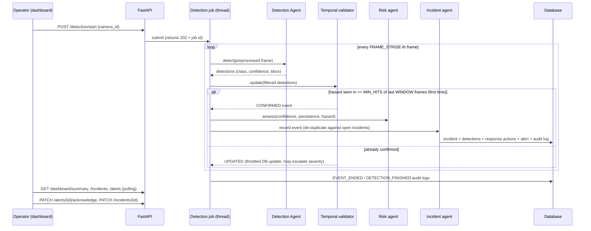

# Architecture

## 1. Component view



## 2. End-to-end workflow



## 3. The "agents"

The agents are ordinary Python classes with explicit inputs and outputs, called
in a fixed order by the orchestrator. They are **not** autonomous AI agents and
do not plan, learn or act on their own.

| Agent | Module | Input -> output |
|---|---|---|
| Detection Agent | `ai/detector.py` | BGR frame -> `list[Detection]` (hazard, confidence, bbox) |
| (validation) | `ai/postprocessor.py` | detections per frame -> `TrackEvent` CONFIRMED / UPDATED / ENDED |
| Risk Assessment Agent | `services/risk_service.py` | hazard, mean confidence, persistence -> `RiskAssessment` (score, severity) |
| Response Recommendation Agent | `services/response_service.py` | hazard, severity -> `list[ResponseRecommendation]` |
| Incident Management Agent | `services/incident_service.py` | event + risk -> incident row (create / merge / escalate) |
| Alert Agent | `services/alert_service.py` | incident -> dashboard alert; acknowledgement |
| Audit Agent | `services/audit_service.py` | decision -> `system_logs` row |
| Orchestrator | `services/pipeline.py`, `services/detection_service.py` | runs the above per frame / per job |

## 4. Detection modes

| `DETECTOR_MODE` | Behaviour | Status reported |
|---|---|---|
| `yolo` | Loads `MODEL_WEIGHTS_PATH`; verifies its class names map to hazards | `READY` or `MODEL_NOT_AVAILABLE` (detection endpoints return 503) |
| `auto` (default) | Trained model if usable, else the demo heuristic | `READY` or `DEMO_MODE` |
| `demo` | HSV colour heuristic for bright red/orange/yellow regions -> `FIRE` only | `DEMO_MODE` |

Demo-mode incidents are stored with `source = DEMO_HEURISTIC`, their description
starts with `[DEMO HEURISTIC ...]`, every detection has `is_demo = true`, and the
dashboard shows a dashed **Demo** badge and a banner. Smoke, accident, spark and
fall detection require a trained model; the demo cannot detect them.

## 5. Temporal validation and duplicate prevention

* One track per (video source, hazard type).
* A track is confirmed when the hazard appears in at least `TEMPORAL_MIN_HITS`
  of the last `TEMPORAL_WINDOW_FRAMES` *processed* frames (default 5 of 8).
  With `FRAME_STRIDE=5` at 25 fps this means about 1–1.6 s of persistence.
* Single-frame flashes never confirm.
* After confirmation the track only produces `UPDATED` events, so one continuous
  event never creates a second incident. Incident rows are updated every
  `INCIDENT_UPDATE_EVERY_N_HITS` hits.
* A track ends after `TEMPORAL_END_AFTER_MISSED` processed frames without the hazard.
* Across jobs, a new confirmed event on the **same camera** and **same hazard** is
  merged into an *active* incident whose last detection is within
  `INCIDENT_DEDUP_WINDOW_SECONDS` (default 300 s). Uploads without a camera are not
  merged across uploads.

## 6. Risk model (prototype design)

```
Risk = 100 × (w_c·C + w_p·P + w_s·S)        (weights normalised to sum to 1)
C = mean confidence of the event                      0..1
P = min(1, positive frames / PERSISTENCE_SATURATION_FRAMES)   0..1
S = hazard severity factor × context multiplier       0..1 (clamped)
```

| Band | Score |
|---|---|
| LOW | 0 – 30 |
| MEDIUM | > 30 – 55 |
| HIGH | > 55 – 75 |
| CRITICAL | > 75 – 100 |

Default weights: confidence 0.40, persistence 0.30, severity 0.30.
Default severity factors: fire 0.90, road accident 0.85, person fall 0.75,
electrical spark 0.70, smoke 0.60.

**All weights, factors and bands are design parameters chosen for the prototype.
They have not been calibrated or validated against real incident outcomes.**
Severity escalates automatically when a later assessment is higher; it is never
lowered automatically (an operator can override it).

Worked example: fire, mean confidence 0.80, 15 positive frames ->
`100 × (0.4×0.80 + 0.3×1.00 + 0.3×0.90) = 89.0` -> CRITICAL.

## 7. Concurrency

* Detection runs in daemon worker threads managed by `DetectionJobManager`, so
  requests return immediately (`202 Accepted`) and the event loop is never blocked.
* `MAX_CONCURRENT_JOBS` (default 2) limits CPU load; one job per camera.
* Each job owns its `VideoSource` and DB sessions and releases them in `finally`.
* SQLite writes from jobs are serialised with a lock; WAL mode lets the API read
  concurrently. For many cameras use PostgreSQL and a task queue (future work).
* A single YOLO model instance is shared and guarded by a lock.

## 8. Known limitations

* No trained hazard model is included; only the demo heuristic runs out of the box.
* The demo heuristic flags any bright orange/red region (sunsets, vests, tail
  lights) and misses fire that is not in that colour range.
* Accident and fall detection with bounding boxes is inherently weak; pose/
  sequence models would be better (future work).
* Same-type simultaneous hazards in one view are merged into one track.
* Live preview is a periodically refreshed processed frame, not a video stream.
* Job state is in memory: restarting the server forgets running/finished jobs
  (incidents remain in the database).
* RTSP credentials are masked in all API output but stored unencrypted in the DB.
* No login rate-limiting, no refresh tokens, no user-management UI (use the script).
* CPU-only inference on large videos is slow; increase `FRAME_STRIDE` or use a GPU.
* No external notifications or emergency dispatch of any kind.
